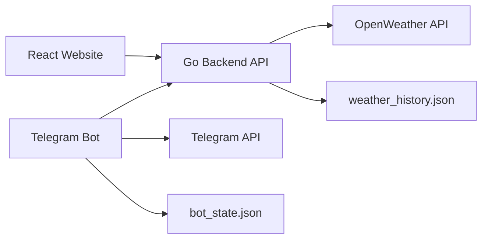

# 🌤️ WeatherNow

**WeatherNow** is a weather monitoring application that provides real-time weather information, weather forecasts, and temperature history through a modern web dashboard and an interactive Telegram bot.

The application uses a centralized **Go backend API** to retrieve weather data from OpenWeather, making it accessible through both the website and Telegram bot.

🌐 **Web Dashboard:** WeatherNow  
🤖 **Telegram Bot:** [@weather_royyan_bot](https://t.me/weather_royyan_bot)

---

## ✨ Features

### 🌐 Web Dashboard

- **Current Weather** – Displays current temperature, feels-like temperature, weather conditions, humidity, and wind speed.
- **Sunrise & Sunset** – Provides local sunrise and sunset information.
- **5-Day Forecast** – Shows upcoming weather conditions for the next five days.
- **Hourly Forecast** – Displays 3-hour forecast intervals with standard OpenWeather API access, or hourly forecasts when One Call API is enabled.
- **Weather Alerts** – Provides rain and high-temperature warnings based on forecast data, with official alerts when One Call is available.
- **Favorite Cities** – Add and remove favorite cities for quick weather access.
- **Temperature History** – Visualizes historical temperature data through interactive charts.
- **Multi-language Support** – Switch between Indonesian and English.
- **Local Preferences** – Saves favorite cities and language preferences using browser localStorage.

### 🤖 Telegram Bot

- **Interactive Menu** – Easy-to-use buttons for weather, forecasts, favorites, and notification settings.
- **Current Weather** – Get weather information by entering a city name.
- **Location-based Weather** – Retrieve weather information by sharing your location in a private chat.
- **Weather Forecast** – Get upcoming weather forecasts directly through Telegram.
- **Favorite Cities** – Add, view, and remove favorite locations.
- **Scheduled Notifications** – Receive daily weather summaries at a preferred time.
- **Notification Settings** – Customize notification schedules or unsubscribe whenever needed.
- **Text Commands** – Access bot features using Telegram commands.

**Available Commands:**

| Command | Description |
|---|---|
| `/weather` | Get current weather information |
| `/forecast` | Get weather forecasts |
| `/subscribe` | Subscribe to daily weather notifications |
| `/unsubscribe` | Disable daily notifications |
| `/time` | Configure notification time |
| `/favorites` | View favorite cities |

---

## 🛠️ Tech Stack

| Component | Technologies |
|---|---|
| Frontend | React 19, TypeScript, Vite |
| Styling | CSS |
| Backend API | Go, HTTP, JSON |
| Telegram Bot | Go, Telegram Bot API |
| Weather Provider | OpenWeather API |
| Browser Storage | localStorage |
| Data Storage | JSON Files |
| Version Control | Git & GitHub |

---

## 🏗️ System Architecture

WeatherNow uses a centralized backend architecture where the website and Telegram bot communicate with the same weather data provider through separate application processes.



### Application Workflow

1. Users access weather information through the React website or Telegram bot.
2. The Go backend receives weather requests and retrieves the required information from OpenWeather.
3. The backend processes and returns weather data in JSON format.
4. Temperature history is stored locally for visualization.
5. The Telegram bot manages user preferences, favorite cities, and notification subscriptions.

---

## 📂 Project Structure

```text
WeatherNow/
├── .gitignore
│
├── WeatherNowDashboard/
│   ├── BackEnd/
│   │   ├── main.go
│   │   ├── go.mod
│   │   └── .env.example
│   │
│   └── frontend/
│       ├── src/
│       │   ├── App.tsx
│       │   ├── main.tsx
│       │   └── index.css
│       ├── package.json
│       └── index.html
│
└── wheaternow/
    ├── main.go
    ├── go.mod
    └── .env.example
```

---

## ⚙️ Installation & Setup

### Prerequisites

Make sure you have installed:

- [Go](https://go.dev/dl/)
- [Node.js](https://nodejs.org/)
- [npm](https://www.npmjs.com/)
- [OpenWeather API Key](https://openweathermap.org/api)
- [Telegram Bot Token](https://t.me/BotFather)

### 1. Clone the Repository

```bash
git clone https://github.com/your-username/WeatherNow.git
cd WeatherNow
```

### 2. Configure the Backend

Navigate to the backend directory:

```bash
cd WeatherNowDashboard/BackEnd
```

Copy `.env.example` into `.env` and configure the required environment variables according to the example file.

At minimum, configure your OpenWeather API key and other settings required by the backend.

Start the backend:

```bash
go mod download
go run main.go
```

The backend API will run locally at:

```text
http://localhost:8080
```

### 3. Run the Frontend

Open another terminal:

```bash
cd WeatherNow/WeatherNowDashboard/frontend
```

Install dependencies:

```bash
npm install
```

Start the development server:

```bash
npm run dev
```

Open the local URL provided by Vite in your browser.

### 4. Configure the Telegram Bot

Open another terminal and navigate to the bot directory:

```bash
cd WeatherNow/wheaternow
```

Configure the environment variables using `.env.example` as a reference. Add your Telegram Bot Token and the required backend configuration.

Install dependencies and start the bot:

```bash
go mod download
go run main.go
```

You can now interact with WeatherNow through Telegram:

**[Open WeatherNow Telegram Bot](https://t.me/weather_royyan_bot)**

---

## 🔐 Environment Configuration

The project uses `.env` files to manage API credentials and application settings.

Refer to the following example files:

- `WeatherNowDashboard/BackEnd/.env.example`
- `wheaternow/.env.example`

Never upload your actual `.env` files, API keys, or Telegram Bot Tokens to a public repository.

---

## 📊 Additional Information

- The backend runs on port `8080` by default.
- Weather history is stored in `weather_history.json`.
- Telegram bot preferences and subscriptions are stored in `bot_state.json`.
- Website preferences are stored in browser `localStorage`.
- The Telegram bot must remain running to deliver scheduled weather notifications.
- The backend implements caching and per-IP request limits to help manage API requests.
- Hourly forecasts, UV index, and official weather alerts require OpenWeather One Call API access.

To enable One Call functionality, configure:

```env
OPENWEATHER_ONECALL_ENABLED=true
```

Make sure your OpenWeather account has access to the required One Call API features.

---

## 🚀 Deployment

WeatherNow consists of three independently running components:

1. **Frontend** – Deploy the React application to a web hosting platform.
2. **Backend** – Deploy the Go API to a server or cloud hosting environment.
3. **Telegram Bot** – Run the Go bot on an environment that supports continuous execution.

For production deployment, configure the frontend to communicate with the publicly accessible backend API URL instead of `localhost`.

---

## 👨‍💻 Developer

**Fauzan Arroyyan**

Informatics Graduate | Web Developer | AI & Machine Learning Enthusiast

Interested in software development, data analytics, and building practical technology solutions.

---

⭐ If you find this project interesting, feel free to explore the repository and try the WeatherNow Telegram Bot!

[**Try WeatherNow on Telegram →**](https://t.me/weather_royyan_bot)
